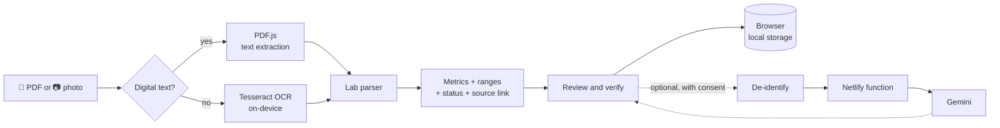
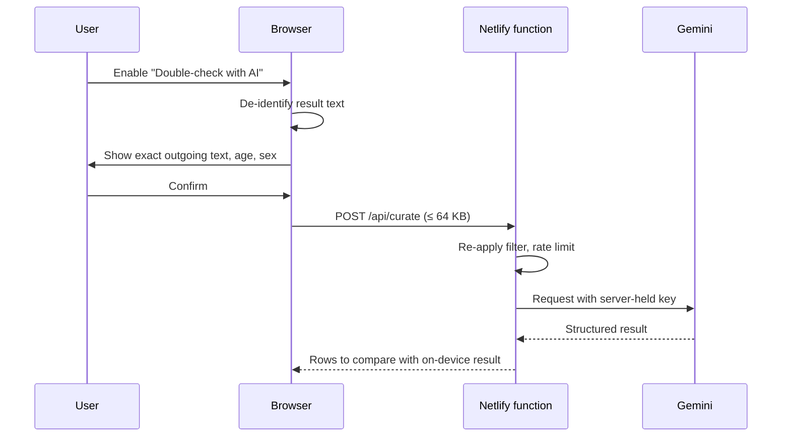

<div align="center">


# LabLens

### Lab reports, simplified.

**Read PDF and photo lab reports in your browser. See every value beside its normal range, and trace it back to the exact spot in the original.**


[Features](#-features) · [How it works](#-how-it-works) · [Privacy](#-privacy-first) · [Quick start](#-quick-start) · [Architecture](#-architecture) · [Testing](#-testing) · [Deployment](#-deployment) · [Docs](#-documentation)

</div>

---

## ✨ Overview

LabLens turns a dense lab report into something a person can actually read. Upload a PDF or snap a photo, and LabLens extracts each test result, places it next to its reference range, flags what is out of range, and links every number back to the source text so nothing has to be taken on trust.

Everything runs **in the browser**. PDF parsing and OCR happen on your device with no account and no upload. AI rechecking is strictly optional, and you review the exact text before anything leaves the page.

> [!IMPORTANT]
> LabLens helps you *read* a report. It is not a medical device and does not diagnose. Always discuss results with the clinician who ordered them.

> [!NOTE]
> This branch is the **web deployment**. It contains no iOS or Android project files. The separate `mobile-development` branch preserves the native app prototypes.

---

## 🚀 Features

| | Feature | What it does |
|---|---|---|
| 📄 | **PDF and photo import** | Reads digital PDFs directly (PDF.js) and falls back to on-device OCR (Tesseract) for scans and phone photos. Add several files at once, as one merged report or one report per file. |
| 📏 | **Values beside ranges** | Every result is shown with its unit and reference range, and classified as in range, high or low. Age and sex aware ranges are applied where they matter. |
| 🔗 | **Source linking** | Each value links back to its place in the original document, with an evidence overlay on the page image. |
| 🧪 | **Wide report parsing** | Handles wrapped labels, split rows, markdown-style tables, previous-result columns, decimal commas, comparison symbols (`<`, `>`), blood pressure, urinalysis and qualitative findings. |
| 🗂️ | **Report types** | Auto-detects the document type (lab panels, clinical notes and more) and lets you correct it. |
| 📊 | **Trends over time** | Compares the same marker across saved reports so you can see what moved. |
| 👨‍👩‍👧 | **Family profiles** | Keep separate profiles, with a family overview showing each person's latest readings and biggest changes. |
| 🩺 | **Doctor summary PDF** | Save or print a clean summary to bring to an appointment. A sample report preview is built in. |
| 💬 | **Ask AI chat** | Optional Q&A about a report (max 3 questions per report), using only de-identified context you can inspect. |
| 🤖 | **Double-check with AI** | Optional second opinion on extraction. You see the exact outgoing text, age and sex, and must confirm before each send. |
| 💊 | **Medication and follow-ups** | Picks up medication records and follow-up dates from prescriptions and notes. |
| 🔍 | **Search and filters** | Search scan history by report, date, tag or note. Filter by *Needs review* or *In range*. |
| 💾 | **Backup and restore** | Export profiles, reports and medications as JSON, with an automatic pre-restore recovery download. |
| 📱 | **Installable PWA** | Works offline after first load. Add to Home Screen on iOS or install from Chrome on Android. |
| ♿ | **Accessible UI** | Keyboard-navigable tabs, ARIA roles and labels, and a responsive mobile layout with a sticky header. |

---

## 🔬 How it works



1. **Import.** Choose files or take a photo. Pick a report type or let LabLens detect it.
2. **Extract.** Digital PDFs yield text directly. Scans and photos go through local OCR, with a confidence score per word.
3. **Parse.** The parser matches test names, reads values, units and reference ranges, and applies age/sex ranges and qualitative classifiers.
4. **Review.** Low-confidence or ambiguous values are flagged for you to check against the original rather than silently trusted.
5. **Save.** Results are stored in your browser, grouped by profile, ready for trends and comparison.
6. **Optionally double-check.** Review the redacted text, then send. The AI result is compared against the on-device result.

### Result views

Each report opens into five tabs:

| Tab | Shows |
|---|---|
| **Summary** | Plain-language overview, health status, key values, tags and notes |
| **Values** | Every extracted value with unit, range and status |
| **Original** | The source document with evidence overlays |
| **Trends** | The same markers compared across reports |
| **Next steps** | Suggested follow-ups and questions for your clinician |

---

## 🔒 Privacy first

| Principle | In practice |
|---|---|
| **On-device by default** | PDF parsing and OCR run locally. No account, no upload. |
| **No third-party code at runtime** | PDF.js and Tesseract are vendored in the repo. No CDN scripts are executed. |
| **Consent before AI** | A dialog shows the exact outgoing text, age and sex. Declining falls back to on-device only. |
| **Server checks the redaction too** | The function applies the same filter and rejects text that would change server-side. |
| **No telemetry** | LabLens does not track you. Feedback opens your email app with a draft; nothing is transmitted. |
| **Strict CSP** | `default-src 'self'`, `connect-src 'self'`, `object-src 'none'`, `frame-ancestors 'none'`. |
| **Hardened PDF.js** | Loaded with `isEvalSupported: false` as a mitigation for CVE-2024-4367. |

> [!WARNING]
> Reports and profiles are stored in browser local storage, which is **not encrypted**. Anyone with access to the browser profile can read them. Exported JSON backups are also unencrypted, so keep them somewhere private. Automatic redaction is best effort, so always inspect the preview before sending.

---

## ⚡ Quick start

**Requirements:** Node.js 18 or newer. Chrome is needed only for the browser tests. There is nothing to `npm install`, because the project has no dependencies.

```sh
# Clone and enter the project
git clone <repo-url> && cd LabLens_Ver12

# Run the app locally at http://localhost:8765
npm run dev
```

To try the optional AI features locally, pass a key:

```sh
GEMINI_API_KEY=your-key npm run dev   # serves the app plus /api/curate and /api/chat
```

Without a key the app works fully on-device, and "Double-check with AI" falls back to the on-device reader.

### Handy scripts

| Command | Purpose |
|---|---|
| `npm run dev` | Local static server with the `/api/curate` and `/api/chat` functions |
| `npm test` | Unit tests (Node's built-in test runner) |
| `npm run build:web` | Build the deployable `dist-web` folder |
| `npm run test:ui` | Browser smoke test of the app's buttons and flows (needs Chrome) |
| `npm run benchmark:ocr` | Replay the saved synthetic OCR result through the scorer |
| `npm run benchmark:ocr:live` | End-to-end OCR smoke test with five synthetic images in headless Chrome |
| `npm run probe:parser` | Run the report parser on a file and print the output |
| `npm run probe:pdf` | Probe PDF text extraction |
| `npm run probe:curation` | Show what would be sent to AI and how AI rows compare |

---

## 🏗️ Architecture

LabLens is a deliberately simple, build-free static app: plain HTML, CSS and ES modules, with a thin serverless layer used only for optional AI.

```text
LabLens_Ver12/
├── index.html                 App shell, styles and markup
├── app.js                     UI, state, storage, import and results flow
├── service-worker.js          Offline app shell and update strategy
├── manifest.webmanifest       PWA manifest
├── netlify.toml               Build, headers and Content-Security-Policy
│
├── src/
│   ├── core/
│   │   ├── lab-parser.mjs     Text to metrics: names, values, units, ranges, status
│   │   ├── chat-context.mjs   Builds the de-identified context for Ask AI
│   │   └── family-summary.mjs Profile overview, latest readings, marker changes
│   ├── ocr/
│   │   ├── schema.mjs         OCR result contract (pages, words, polygons, metrics)
│   │   ├── benchmark.mjs      Accuracy scoring for the OCR benchmark
│   │   └── device-profile.mjs Device and run telemetry for benchmarks
│   └── privacy/
│       └── deidentify.js      Redaction of names, IDs and other personal details
│
├── netlify/
│   ├── functions/
│   │   ├── curate.mjs         POST /api/curate  AI double-check
│   │   └── chat.mjs           POST /api/chat    Ask AI Q&A
│   └── lib/proxy-common.mjs   Shared validation, limits and Gemini calls
│
├── vendor/                    Vendored PDF.js, Tesseract.js, WASM core, English OCR data, font
├── scripts/                   Build, dev server, probes and test runners
├── tests/                     Unit tests
├── test-fixtures/             Synthetic OCR benchmark fixtures and manifest
└── docs/                      Deployment, OCR and architecture notes
```

### Tech stack

| Layer | Choice |
|---|---|
| Front end | Vanilla JavaScript (ES modules), HTML and CSS. No framework and no bundler. |
| PDF text | PDF.js `3.11.174` (vendored) |
| OCR | Tesseract.js `5.1.0` with the English `4.0.0` model, running as WASM in a worker |
| Storage | Browser local storage, per profile |
| Offline | Service worker with a network-first HTML shell, so fixes ship on the next load |
| Serverless | Netlify Functions (Node ESM) |
| AI | Google Gemini, via a server-side proxy that holds the key |
| Tests | `node --test` plus a headless Chrome smoke runner |

### Why no build step?

Zero build tooling means zero transitive dependencies to audit, which matters for a tool that parses medical data client-side. It also keeps the service worker's promise simple: a fix to a wrong lab reading goes live on the next load. See [docs/scale_architecture.md](docs/scale_architecture.md) for the trade-offs of introducing a bundler later.

### Optional AI proxy



| Limit | Value |
|---|---|
| Request body | 64 KB |
| Per client | 30 requests per hour |
| Per function instance | 300 requests per hour |
| Ask AI questions | 3 per report |
| Function timeout | 10 s (Netlify default), so long reports are sent in small chunks |

---

## 🧪 Testing

```sh
npm test                                          # unit tests
npm run build:web                                 # build dist-web
LABLENS_STATIC_ROOT=dist-web npm run test:ui      # browser smoke test against the built output
npm run benchmark:ocr:live                        # end-to-end OCR check
```

The unit suite covers the report parser, de-identification, AI curation and its security checks, chat limits, family summaries, result counts, storage advice, the OCR schema and benchmark scorer, and the app shell.

### OCR accuracy

OCR quality is measured, not assumed. The benchmark reports exact numeric-token precision and recall, metric detection recall, exact value, unit and reference-range rates, high-confidence wrong values, and per-page timing.

**Release rule:** no OCR engine may ship with a high-confidence wrong value in the approved corpus. Low-confidence extractions must enter review rather than be shown as fact.

> [!NOTE]
> The current fixtures are synthetic, so the live benchmark is a smoke test, not a clinical accuracy estimate. The real-report corpus is not yet complete. Only synthetic or fully de-identified documents may ever be committed. See [test-fixtures/ocr/README.md](test-fixtures/ocr/README.md).

---

## ☁️ Deployment

Netlify runs `npm run build:web` and publishes only `dist-web`, which keeps tests, fixtures and server code out of static hosting.

```sh
netlify deploy --prod
```

### Environment variables (optional AI)

| Variable | Purpose |
|---|---|
| `GEMINI_API_KEY` | Key for the AI service. Use a paid tier so submitted text is not used for training. |
| `GEMINI_MODEL` | Comma-separated model list tried in order (defaults to two lite models). |
| `GEMINI_PROVIDER` | Set to `vertex` only for a Google Cloud (Vertex AI) key. |

> [!CAUTION]
> Rate-limit counters reset with each serverless instance. **Set a provider-side spending quota before enabling the API key.**

### Installing and updating the PWA

- **iPhone / iPad:** Safari, Share, Add to Home Screen.
- **Android:** Chrome menu, Install app.
- The service worker refreshes the app shell on load. If an old copy stays open, close the app fully and reopen it.
- Bump `CACHE_NAME` in [service-worker.js](service-worker.js) whenever the list of precached assets changes.

Full details are in [docs/DEPLOY.md](docs/DEPLOY.md).

---

## 📦 Vendored runtimes

Third-party runtimes live in [vendor/](vendor/) so report contents never pass through scripts fetched from a CDN.

| Component | Version | Role |
|---|---|---|
| PDF.js | `pdfjs-dist@3.11.174` | PDF text extraction and page rendering |
| Tesseract.js | `5.1.0` | OCR engine and worker |
| Tesseract core | `tesseract.js-core@5.1.0` | WASM OCR core |
| English OCR data | Tesseract `4.0.0` | Language model |
| Manrope | Variable font | UI typography |

License texts sit beside each component, and SHA-256 hashes are listed in [vendor/README.md](vendor/README.md). When updating a version, review upstream changes, refresh the service-worker asset list and rerun the OCR benchmark.

---

## 📚 Documentation

| Document | Contents |
|---|---|
| [docs/DEPLOY.md](docs/DEPLOY.md) | Netlify setup, AI configuration, privacy notes, PWA updates |
| [docs/OCR_PHASE0.md](docs/OCR_PHASE0.md) | OCR measurement foundation, schema contract and release metrics |
| [docs/scale_architecture.md](docs/scale_architecture.md) | Historical note on modularization trade-offs |
| [test-fixtures/ocr/README.md](test-fixtures/ocr/README.md) | How to add and score OCR fixtures safely |
| [vendor/README.md](vendor/README.md) | Vendored runtime versions, licenses and checksums |

---

## 🗺️ Status and known gaps

- The real-report OCR accuracy corpus is not yet complete.
- The canonical OCR schema still needs an explicit coordinate-space and orientation field.
- Local storage is unencrypted by design for now.
- English-language reports only (bundled OCR model).

---

<div align="center">

**LabLens** · private by default · built to be understood

*Not medical advice. Always consult a qualified clinician about your results.*

</div>
